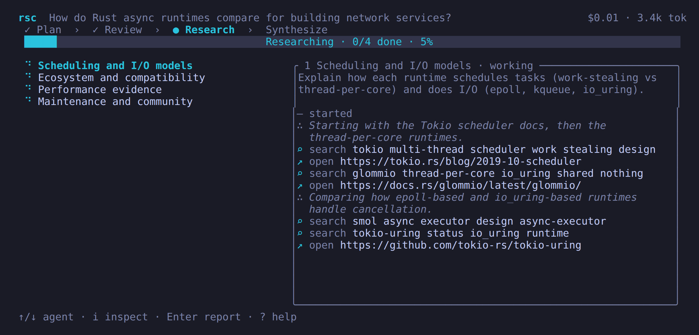

# rsc

Multi-agent deep research in your terminal, powered by your ChatGPT plan.



## What it does

You ask a question; rsc runs this pipeline:

1. A planner does a few web searches and may ask up to 3 clarifying questions, over at most 2 rounds. Submitting empty answers skips them.
2. You review and edit the research angles (1–99).
3. Researchers run in parallel, each with web search. They can optionally use `fetch_url`.
4. A synthesizer writes a single cited Markdown report.

The Run screen shows each agent's live timeline: reasoning summaries, searches, opened pages and the draft as it streams. Reports open in a viewer and can be saved as `.md`. The final report cites sources by number and ends with a `## Sources` list; a Sources tab in the viewer lists every URL the agents cited or opened (Enter opens it, `c` copies it).

## Requirements

- Linux or macOS on x86_64 or arm64. Windows is unsupported (`src/paths.rs` and `src/auth/mod.rs` use `std::os::unix`).
- A ChatGPT account. rsc uses your ChatGPT plan's usage; manage it at <https://chatgpt.com/settings/usage>.

## Install

```sh
curl -fsSL https://raw.githubusercontent.com/sbharga/rsc/master/install.sh | sh
```

This downloads the newest release binary (pre-releases included) for your OS and architecture, verifies its SHA-256 and installs it to `~/.local/bin`. Set `RSC_INSTALL_DIR=/path` to change the directory and `RSC_VERSION=v0.0.1` to pin a version.

### From source

Requires stable Rust with edition 2024, plus a C toolchain and `cmake` because `aws-lc-sys` is built for rustls.

```sh
cargo install --git https://github.com/sbharga/rsc --tag v0.0.1
```

Or from a clone:

```sh
cargo build --release   # produces target/release/rsc
```

## Updating

On launch rsc checks GitHub releases. When a newer one exists, the home screen shows `rsc X available — run rsc update`. `rsc update` installs the newest release over the current binary by running the install script from that release's tag. Turn the check off with `check_updates = false` or in Settings.

## Usage

Run `rsc`. `rsc --version` prints the version; `rsc update` updates rsc.

First launch opens the browser for "Sign in with ChatGPT". A local callback runs on `127.0.0.1` on a random port. If the browser can't open, press `c` to copy the URL.

Then type a question and press Enter. Press `F1` (or `?` where it isn't typed as text) for the keys on any screen.

Global keys:

| Key | Action |
|---|---|
| `Ctrl+G` | Current research |
| `Ctrl+R` | History |
| `Ctrl+O` | Settings |
| `Ctrl+U` | Manage usage |
| `Ctrl+C` | Quit |

## Headless use

```sh
rsc run "<question>" [--agents N] [--yes] [--no-clarify] [-o FILE] [--json]
rsc resume <id> [--yes] [--no-clarify] [-o FILE] [--json]
rsc ls
rsc show <id>
```

`rsc run` works without a terminal. Progress goes to stderr and the report to stdout (or to `-o FILE`). Without a terminal on stdin and stderr, clarifying questions are skipped and `--yes` is required to accept the plan; in a terminal, rsc asks. `--json` prints a summary object on stdout instead of the report. `rsc resume` continues a failed, cancelled or interrupted run; don't resume a run that is still open in another rsc.

Exit codes: `0` done, `1` failed or usage error, `2` done but a budget cap stopped research early, `130` cancelled (Ctrl+C or declining the plan).

## Follow-up chat

On a finished research's report (after it completes, or from History with `Ctrl+R`), press `a` to ask follow-up questions. Answers stream in, may use web search, and are saved per research, so reopening it continues the conversation. Chat cost is shown on the chat screen and is not added to the research's total.

## Data and privacy

Everything lives under `~/.rsc` (directories 0700, files 0600, written atomically):

| Path | Contents |
|---|---|
| `accounts/<id>.json` | OAuth tokens |
| `state.json` | Active account |
| `config.toml` | Settings |
| `pricing.toml` | Cost-estimate rates, seeded on first run |
| `research/<id>/research.json` | Run record |
| `research/<id>/agents/<n>.md` | Per-agent reports |
| `research/<id>/agents/<n>.state.json` | Researcher progress for resume; removed when the agent finishes or fails |
| `research/<id>/report.md` | Final report |
| `research/<id>/chat.json` | Follow-up chat |

- API requests are sent with `store: false`. Whether OpenAI may train on your data is set by your ChatGPT account's Data Controls.
- `fetch_url` is off by default. When on, it downloads http(s) URLs the model picks, from your machine. rsc refuses loopback, private, link-local, unique-local, CGNAT and other non-public addresses, including through redirects (max 5) and DNS. It ignores system proxy settings so this check always applies.
- Pages can contain instructions aimed at the model (prompt injection). rsc marks fetched text as untrusted, but a prompt cannot fully prevent a model from, for example, putting your question into a URL it fetches. The site would then see it. Leave `fetch_url` off if that matters.
- Unless `check_updates` is off, each launch sends one unauthenticated request to `api.github.com` to check for releases.

## Configuration

`~/.rsc/config.toml` keys and defaults:

| Key | Default | Notes |
|---|---|---|
| `planner` | `{model = "", effort = "medium"}` | Empty model = first model in the catalog |
| `researcher` | `{model = "", effort = "medium"}` | Empty model = first model in the catalog |
| `compactor` | `{model = "", effort = "low"}` | Empty model = first model in the catalog |
| `synthesizer` | `{model = "", effort = "high"}` | Empty model = first model in the catalog |
| `default_agents` | `4` | Clamped to 1–99 |
| `max_parallel` | `3` | Clamped to 1–99 |
| `report_words` | `0` | `0` = the researcher sizes each report to the problem; otherwise minimum 100 |
| `report_style` | `""` | Instructions for how the final report and chat answers are written, e.g. `Explain like I'm 5`. Applies to new runs |
| `max_turns` | `30` | |
| `compact_threshold_tokens` | `200000` | |
| `synth_input_budget_tokens` | `120000` | |
| `max_run_tokens` | `0` | Run budget in tokens (all stages); `0` = no cap. When reached, no new researchers start, running ones write their report, and synthesis completes. The report notes it. |
| `max_run_cost_usd` | `0` | Same cap in estimated USD from `pricing.toml`; models without rates count only web-search cost. |
| `fetch_url_enabled` | `false` | |
| `check_updates` | `true` | Check GitHub for a newer release on launch |

Most of these are editable in Settings (`Ctrl+O`). If `config.toml` is invalid, rsc falls back to the defaults and shows a banner.

`pricing.toml` holds per-model USD rates per 1M tokens plus web-search cost. Displayed costs are estimates; models without rates show token counts instead.

## Development

```sh
cargo fmt
cargo clippy --all-targets -- -D warnings
cargo test
```

See [AGENTS.md](AGENTS.md) for architecture and conventions.

## License

Licensed under either of

- Apache License, Version 2.0 ([LICENSE-APACHE](LICENSE-APACHE))
- MIT license ([LICENSE-MIT](LICENSE-MIT))

at your option.

Unless you explicitly state otherwise, any contribution intentionally submitted for inclusion in the work by you, as defined in the Apache-2.0 license, shall be dual licensed as above, without any additional terms or conditions.
